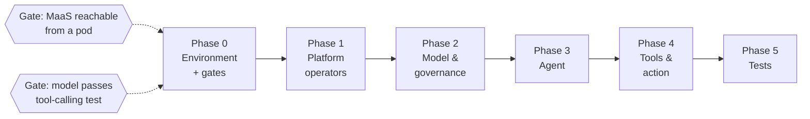

# Installation runbook

Step-by-step implementation of the POC. Each step lists the command, how to verify it,
and what to record in the [test log](test-log.md). Steps are numbered as in the original plan.



> Phase 4 creates objects the agent depends on (MCP servers, AAP token). In practice:
> deploy `demo-apps` and `tools` **before** the agent and fill `AAP_MCP_TOKEN` before
> starting OpenClaw. The order in the [Quick start](../README.md#quick-start) already
> does this.

## Prerequisites

| Tool | Used for |
|---|---|
| `oc` (logged in as cluster-admin) | Everything |
| `python3` (3.9+, standard library only) | Model validation, rendering |
| `ansible-core` + collections in [aap/config-as-code/requirements.yml](../aap/config-as-code/requirements.yml) | AAP configuration as code |
| `curl`, `openssl` | Quota test, token generation |

```bash
cp .env.example .env
# generate the OpenClaw tokens
sed -i "s/^OPENCLAW_GATEWAY_TOKEN=.*/OPENCLAW_GATEWAY_TOKEN=\"$(openssl rand -hex 32)\"/" .env
sed -i "s/^OPENCLAW_HOOKS_TOKEN=.*/OPENCLAW_HOOKS_TOKEN=\"$(openssl rand -hex 32)\"/" .env
```

The Git repository must be reachable by AAP (project sync). Publish it on GitHub first
and set `GIT_REPO_URL` in `.env`.

---

## Phase 0: Environment

### 1. Validate cluster access

```bash
make preflight
```

Checks login, OpenShift version, nodes, default StorageClass, S3 (NooBaa), user workload
monitoring, catalog packages, and that no GPU operator is installed. Read-only.

### 2. Validate egress to the internal MaaS (**gate**)

```bash
make egress-check
```

Runs a short-lived pod in `poc-preflight` that calls `${MAAS_INTERNAL_URL}/models` with
the key mounted from a temporary Secret. **If this fails, stop here**: fix proxy,
firewall or egress rules first.

### Model pre-validation (**gate**, plan §5)

```bash
make model-list                 # choose a model with tool-calling support, set MAAS_MODEL
make model-validate             # 5 scenarios x 3 runs, 3 fictitious tools
```

| Check | Where |
|---|---|
| Endpoint accepts `tools` | The script stops with an explicit error if not |
| Right tool + right arguments in most attempts | Summary line `right tool + args`; GO when ≥ 80% |
| Key limits (requests/min, tokens/day) | `rate-limit headers` in the summary + MaaS documentation |
| Usage policy allows lab logs (fictitious data) | Confirm with the internal MaaS owners |

Record model, accuracy and limits in the test log. **NO-GO → switch models.**

### 3. Storage

Already satisfied in the target cluster: ODF with default `ocs-external-storagecluster-ceph-rbd`
and NooBaa S3 (`openshift-storage.noobaa.io`). MLflow and EvalHub buckets are claimed
with `ObjectBucketClaim` in Phase 2. No MinIO needed.

### 4. User workload monitoring

```bash
make phase0
oc -n openshift-user-workload-monitoring get pods     # prometheus-user-workload-*, thanos-ruler-*, alertmanager-user-workload-*
```

> If `cluster-monitoring-config` already exists, merge `enableUserWorkload: true` instead
> of applying the file.

---

## Phase 1: Platform

### 5. cert-manager and Red Hat Connectivity Link

cert-manager Operator 1.20.1 is **already installed** (namespace `cert-manager-operator`).
RHCL is installed by the next target.

### 6–7. Operators and platform instances

```bash
make operators      # RHCL, RHOAI 3.5 (stable-3.5), AAP 2.6 (stable-2.6), External Secrets
make platform       # ExternalSecretsConfig, Kuadrant, DataScienceCluster, AnsibleAutomationPlatform
```

| Component | Verify |
|---|---|
| RHOAI | `oc get dsc default-dsc -o jsonpath='{.status.phase}'` → `Ready` |
| Components | `oc get dsc default-dsc -o jsonpath='{.status.conditions}' \| jq` (kserve, trustyai, mlflowoperator Ready; others Removed) |
| Kuadrant | `oc get kuadrant -n kuadrant-system` → Ready |
| AAP | `oc get ansibleautomationplatform -n aap` ; `oc get route -n aap` ; admin password: `oc get secret aap-admin-password -n aap -o jsonpath='{.data.password}' \| base64 -d` |
| ESO | `oc get pods -n external-secrets` |

The DataScienceCluster ([datasciencecluster.yaml](../manifests/phase1-platform/rhoai/datasciencecluster.yaml))
keeps only dashboard, kserve (+ MaaS), trustyai and mlflowoperator. The AAP instance
disables Automation Hub and Lightspeed.

Store `AAP_GATEWAY_URL` and `AAP_ADMIN_PASSWORD` in `.env`.

### Validate preview schemas

```bash
make explain-crds          # writes evidence/crd-schemas/*.txt
```

Compare with the `TEMPLATE` files (MaaS, NemoGuardrails, MLflow, EvalHub,
AnsibleMCPServer) and fix them before Phase 2. Record the differences in
[open-points.md](open-points.md).

---

## Phase 2: Model and governance

### 8. Models-as-a-Service with the external model

Follow [manifests/phase2-governance/maas/README.md](../manifests/phase2-governance/maas/README.md):
register the internal MaaS as an external model, create the `openclaw-agent` and
`other-consumer` subscriptions, generate the keys, and set `RHOAI_MAAS_URL`,
`AGENT_MAAS_KEY` and `OTHER_CONSUMER_MAAS_KEY` in `.env`.

```bash
scripts/01-maas-egress-check.sh "$RHOAI_MAAS_URL" AGENT_MAAS_KEY
python3 model-validation/tool_calling_test.py --base-url "$RHOAI_MAAS_URL" --api-key "$AGENT_MAAS_KEY" --runs 1
```

Fallback: leave `RHOAI_MAAS_URL` empty. `make render` then points the agent at
`MAAS_INTERNAL_URL` and prints a warning.

### 9–11. Guardrails, MLflow, EvalHub

```bash
make governance            # renders guardrails config, applies phase2-governance, creates secrets
```

| Item | Verify / do |
|---|---|
| NeMo Guardrails | `oc get nemoguardrails,pods -n aiops-governance`; test with a prompt containing `password: hunter2hunter2` → blocked |
| Tool-call passthrough | Run `model-validation/tool_calling_test.py --base-url <guardrails-url>/v1`; if tools break, record the limitation |
| MLflow | Open MLflow from the RHOAI dashboard; create the experiment `openclaw-aiops`; set `MLFLOW_TRACKING_URL`, `MLFLOW_EXPERIMENT_ID`, `MLFLOW_TOKEN` |
| EvalHub | Submit [evaluation-request.json](../manifests/phase2-governance/evalhub/evaluation-request.json) (Garak probes) against the model; record whether red teaming works against an external model without GPU |

To test topology B (Guardrails → MaaS), set `GUARDRAILS_UPSTREAM_URL=$RHOAI_MAAS_URL`
and point `MAAS_BASE_URL` at the guardrails Service. Record which topology works.

---

## Phase 4 (part 1): demo apps and read-only tools

These steps come before the agent because the agent configuration points to them.

### Demo apps and alert routing

```bash
make demo-apps
oc get pods,prometheusrule,alertmanagerconfig -n demo-apps
```

### 16. Read-only MCP servers

```bash
make tools
oc get pods -n aiops-tools
```

Pin the image tags in [phase4-tools/kustomization.yaml](../manifests/phase4-tools/kustomization.yaml)
and record them in the test log.

### 17–20. AAP catalog, Ansible MCP server, approval workflows, EDA

```bash
ansible-galaxy collection install -r aap/config-as-code/requirements.yml
make aap-config            # organization, users, credential, project, catalog, workflows, roles, EDA
# copy openclaw-agent.token into .env as AAP_MCP_TOKEN, then delete the file
make ansible-mcp           # after validating the AnsibleMCPServer template
make secrets
```

| Object | Name |
|---|---|
| Job templates | `restart-deployment`, `scale-deployment`, `rollback-deployment`, `collect-diagnostics`, `set-memory-limit` (EDA only) |
| Workflows (approval → job) | `wf-restart-deployment`, `wf-scale-deployment`, `wf-rollback-deployment` |
| Users | `openclaw-agent` (execute workflows + collect-diagnostics), `poc-approver` (approve), `eda-automation` (execute set-memory-limit) |
| EDA | project `aiops-poc-rulebooks`, activation `aiops-known-events` (Service `aiops-known-events:5000`) |

Set `AAP_MCP_URL` in `.env` to the Ansible MCP Service (`oc get svc -n aap`) and make sure
the pod label matches the `allow-egress-tools` NetworkPolicy (`app.kubernetes.io/component: mcp-server`).

---

## Phase 3: Agent

### 12. Namespace with default-deny

Applied by both deployment plans (`manifests/phase3-agent/base`).

### 13. OpenClaw deployment

- **Plan A**: starter kit, see [starter-kit/README.md](../manifests/phase3-agent/starter-kit/README.md).
- **Plan B**:

```bash
make agent-plan-b
oc -n openclaw get pods,externalsecret,networkpolicy
oc -n openclaw exec deploy/openclaw -- node dist/index.js doctor     # config validation (VERIFY command)
```

Open the Control UI (URL printed by the target) and authenticate with
`OPENCLAW_GATEWAY_TOKEN`.

### 14–15. Model, traces and heartbeat

Configured in [openclaw.json5](../manifests/phase3-agent/openclaw/openclaw.json5) and
`agent.env` (rendered by `make render`):

| Setting | Value |
|---|---|
| Model provider | `rhoai-maas` → `MAAS_BASE_URL`, key `MAAS_API_KEY` (agent subscription) |
| Traces | `diagnostics.otel` → `MLFLOW_OTLP_ENDPOINT` with header `x-mlflow-experiment-id` |
| Heartbeat | `OPENCLAW_HEARTBEAT=30m` (protects the quota) |
| Native tools denied | `exec`, `process`, `write`, `edit`, `apply_patch`, `browser`, `canvas`, `nodes` |

Verify:

```bash
make verify                # agent has no write permission anywhere; prints Secret key names only
```

---

## Phase 5: Tests

See [test-plan.md](test-plan.md) and record results in [test-log.md](test-log.md).

## Clean-up

```bash
oc delete -k manifests/demo-apps
oc delete -k manifests/phase4-tools
oc delete -k manifests/phase3-agent/plan-b
oc delete ns poc-vault aiops-models aiops-governance
# Operators: delete AnsibleAutomationPlatform, DataScienceCluster, Kuadrant first, then the Subscriptions/CSVs.
```
