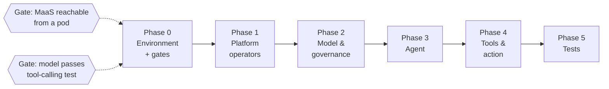

# Installation runbook

Step-by-step implementation of the POC. Each step lists the command, how to verify it,
and what to record in the [test log](test-log.md). Steps are numbered as in the original plan.



> Phase 4 creates objects the agent depends on (MCP servers, AAP token). In practice:
> deploy `demo-apps` and `tools` **before** the agent and fill `AAP_MCP_TOKEN` before
> starting OpenClaw. The order in the [Quick start](../README.md#quick-start) already
> does this.

## Prerequisites

| Tool | Used for |
|---|---|
| `oc` (logged in as cluster-admin) | Everything |
| `python3` (3.9+, standard library only) | Model validation, rendering |
| `curl` | Quota test, AAP API calls |

No local Ansible is needed: `make aap-config` runs the configuration as code inside the
cluster with AAP's own execution environment.

```bash
cp .env.example .env
# generate the OpenClaw tokens
for v in OPENCLAW_GATEWAY_TOKEN OPENCLAW_HOOKS_TOKEN; do
  sed -i "s/^$v=.*/$v=\"$(python3 -c 'import secrets; print(secrets.token_hex(32))')\"/" .env
done
```

The Git repository must be reachable by AAP (project sync). Publish it on GitHub first
and set `GIT_REPO_URL` in `.env`.

---

## Phase 0: Environment

### 1. Validate cluster access

```bash
make preflight
```

Checks login, OpenShift version, nodes, default StorageClass, S3 (NooBaa), user workload
monitoring, catalog packages, and that no GPU operator is installed. Read-only.

### 2. Validate egress to the internal MaaS (**gate**)

```bash
make egress-check
```

`MAAS_INTERNAL_URL` must be the **base** URL ending in `/v1` (not `/v1/chat/completions`).
Runs a short-lived pod in `poc-preflight` that calls `${MAAS_INTERNAL_URL}/models` with
the key mounted from a temporary Secret. **If this fails, stop here**: fix proxy,
firewall or egress rules first.

### Model pre-validation (**gate**, plan §5)

```bash
make model-list                 # choose a model with tool-calling support, set MAAS_MODEL
make model-validate             # 5 scenarios x 3 runs, 3 fictitious tools
```

| Check | Where |
|---|---|
| Endpoint accepts `tools` | The script stops with an explicit error if not |
| Right tool + right arguments in most attempts | Summary line `right tool + args`; GO when ≥ 80% |
| Key limits (requests/min, tokens/day) | `rate-limit headers` in the summary + MaaS documentation |
| Usage policy allows lab logs (fictitious data) | Confirm with the internal MaaS owners |

Record model, accuracy and limits in the test log. **NO-GO → switch models.**

If the summary shows `tool call as text` > 0, the model chose a tool but the endpoint did not
parse it into `tool_calls` (see test-log finding F-01). Compare with `--tool-choice required`
and `--no-tool-hint` to isolate the cause.

### 3. Storage

Already satisfied in the target cluster: ODF with default `ocs-external-storagecluster-ceph-rbd`
and NooBaa S3 (`openshift-storage.noobaa.io`). MLflow and EvalHub use SQLite on a PVC, so no
bucket is needed (NooBaa stays available). No MinIO.

### 4. User workload monitoring

```bash
make phase0
oc -n openshift-user-workload-monitoring get pods     # prometheus-user-workload-*, thanos-ruler-*, alertmanager-user-workload-*
```

> If `cluster-monitoring-config` already exists, merge `enableUserWorkload: true` instead
> of applying the file.

---

## Phase 1: Platform

### 5. cert-manager and Red Hat Connectivity Link

cert-manager Operator 1.20.1 is **already installed** (namespace `cert-manager-operator`).
RHCL is installed by the next target.

### 6–7. Operators and platform instances

```bash
make operators      # RHCL, RHOAI 3.5 (stable-3.5), AAP 2.6 (stable-2.6), External Secrets
make platform       # ExternalSecretsConfig, Kuadrant, DataScienceCluster, AnsibleAutomationPlatform
make maas-prereqs   # Gateway maas-default-gateway, PostgreSQL for MaaS, Authorino CA trust
```

Known issues handled by the repository (details in the [test log](test-log.md#findings)):

- If Kuadrant reports "Gateway API provider not installed", restart its operator pod once
  RHOAI has created the GatewayClass:
  `oc -n kuadrant-system delete pod -l app=kuadrant,control-plane=controller-manager`.
- Do **not** set `public_base_url: ""` in the AAP CR (empty CSRF origin). If it happened,
  delete `aap/aap-gateway-settings` once so the operator regenerates it.
- Keep Authorino listener TLS disabled with RHCL 1.4.3 (`scripts/maas-prereqs.sh` does it).

| Component | Verify |
|---|---|
| RHOAI | `oc get dsc default-dsc -o jsonpath='{.status.phase}'` → `Ready` |
| Components | `oc get dsc default-dsc -o jsonpath='{.status.conditions}' \| jq` (kserve, trustyai, mlflowoperator Ready; others Removed) |
| Kuadrant | `oc get kuadrant -n kuadrant-system` → Ready |
| AAP | `oc get ansibleautomationplatform -n aap` ; `oc get route -n aap` ; admin password: `oc get secret aap-admin-password -n aap -o jsonpath='{.data.password}' \| base64 -d` |
| ESO | `oc get pods -n external-secrets` |

The DataScienceCluster ([datasciencecluster.yaml](../manifests/phase1-platform/rhoai/datasciencecluster.yaml))
keeps only dashboard, aigateway (Models-as-a-Service), kserve, trustyai and mlflowoperator. The AAP instance
disables Automation Hub and Lightspeed.

Store `AAP_GATEWAY_URL` and `AAP_ADMIN_PASSWORD` in `.env`.

### Validate preview schemas

```bash
make explain-crds          # writes evidence/crd-schemas/*.txt
```

Compare with the `TEMPLATE` files (MaaS, NemoGuardrails, MLflow, EvalHub,
AnsibleMCPServer) and fix them before Phase 2. Record the differences in
[open-points.md](open-points.md).

---

## Phase 2: Model and governance

### 8–11. Models-as-a-Service, Guardrails, MLflow, EvalHub

```bash
make governance       # aiops-model (external model), subscriptions, Guardrails, MLflow, EvalHub
make maas-keys        # one key per consumer SA -> .env (AGENT_MAAS_KEY, OTHER_CONSUMER_MAAS_KEY, URLs)
make governance       # re-run once: Guardrails now gets the agent key
set -a; source .env; set +a
python3 model-validation/tool_calling_test.py --base-url "$RHOAI_MAAS_URL" --api-key "$AGENT_MAAS_KEY" --model aiops-model --runs 1
make evalhub          # Garak red-team scan (BENCHMARK=owasp_llm_top10 for the full scan)
```

Consumers must send `"model": "aiops-model"` (the MaaS model name). Set
`GUARDRAILS_ALLOWED_CIDRS` in `.env` (cluster egress IP + machine network) before
`make governance`: the TrustyAI operator exposes Guardrails through a public Route.

Fallback (MaaS external model not working): leave `RHOAI_MAAS_INTERNAL_URL` empty. `make render`
then points the agent and Guardrails straight at `MAAS_INTERNAL_URL` (no MaaS quota) and prints
a warning.

---|---|
| NeMo Guardrails | `oc get nemoguardrails,pods -n aiops-governance`; test with a prompt containing `password: hunter2hunter2` → blocked |
| Tool-call passthrough | `model-validation/tool_calling_test.py --base-url <guardrails-url>/v1`: 15/15 with `passthrough: true` (non-streaming only, test-log F-06/F-09) |
| MLflow | `scripts/mlflow-experiment.sh` creates the experiment `openclaw-aiops` in the workspace `openclaw` and writes `MLFLOW_EXPERIMENT_ID` to `.env` |
| EvalHub | Submit [evaluation-request.json](../manifests/phase2-governance/evalhub/evaluation-request.json) (Garak probes) against the model; record whether red teaming works against an external model without GPU |

Guardrails calls MaaS with its own subscription (`other-consumer` key) and stays **outside the
agent path**: OpenClaw always streams, and NeMo accepts tools only without streaming (test-log
F-05, F-09).

---

## Phase 4 (part 1): demo apps and read-only tools

These steps come before the agent because the agent configuration points to them.

### Demo apps and alert routing

```bash
make demo-apps
oc get pods,prometheusrule,alertmanagerconfig -n demo-apps
```

### 16. Read-only MCP servers

```bash
make tools
oc get pods -n aiops-tools
```

Pin the image tags in [phase4-tools/kustomization.yaml](../manifests/phase4-tools/kustomization.yaml)
and record them in the test log.

### 17–20. AAP catalog, Ansible MCP server, approval workflows, EDA

```bash
make aap-config            # in-cluster: organization, users, credential, project, catalog, workflows, roles, EDA
                           # writes the openclaw-agent token to .env (AAP_MCP_TOKEN)
make ansible-mcp           # AnsibleMCPServer aap-mcp (ClusterIP, port 8086)
make secrets               # push AAP_MCP_TOKEN to poc-vault (ESO syncs it to the agent)
```

| Object | Name |
|---|---|
| Job templates | `restart-deployment`, `scale-deployment`, `rollback-deployment`, `collect-diagnostics`, `set-memory-limit` (EDA only) |
| Workflows (approval → job) | `wf-restart-deployment`, `wf-scale-deployment`, `wf-rollback-deployment` |
| Users | `openclaw-agent` (execute workflows + collect-diagnostics), `poc-approver` (approve), `eda-automation` (execute set-memory-limit) |
| EDA | project `aiops-poc-rulebooks`, activation `aiops-known-events` (Service `aiops-known-events:5000`) |

The agent reaches the Ansible MCP server at `http://aap-mcp.aap.svc:8086/job_management/mcp`
(`openclaw.json5`), allowed by the NetworkPolicy for pods labeled
`app.kubernetes.io/component: ansible-mcp-server`. OpenClaw exposes only 11 of its tools
(`toolFilter`).

---

## Phase 3: Agent

### 12. Namespace with default-deny

`manifests/phase3-agent/base`, applied by `make agent-base` (also part of `make agent`).

### 13. OpenClaw deployment (RHOAI agentic starter kit)

The starter kit (`red-hat-data-services/agentic-starter-kits`, `agents/openclaw`) is used as a
**kustomize remote base pinned to a commit**; `manifests/phase3-agent/starter-kit/kit` adds the
POC layers:

| Overlay change | Why |
|---|---|
| Kit Secret deleted; ESO generates `openclaw-secrets` | Identity layer: credentials come from `poc-vault` |
| Kit ConfigMap replaced by `openclaw-poc-config` (`openclaw.json5`) | Model via MaaS, tools deny-list, MCP servers, hooks, tracing |
| `seed-workspace` init container | Copies `AGENTS.md` (operating rules) on every start |
| `otel-collector` sidecar (from the kit's `mlflow-tracing` overlay) | Traces to MLflow; the projected SA token is mounted **only** in this container |
| `NODE_EXTRA_CA_CERTS` + service CA | Trust the MaaS gateway certificate |
| PVC storage class | `ocs-external-storagecluster-ceph-rbd` instead of `gp3-csi` |

```bash
scripts/mlflow-experiment.sh       # workspace "openclaw", experiment openclaw-aiops -> .env
make agent                         # render + secrets + oc apply -k manifests/phase3-agent/starter-kit
make verify isolation              # 17/17 and 9/9 expected
scripts/agent-alert.sh             # replay an alert; prints tool calls and the agent answer
```

The kit seeds `openclaw.json` **only on the first start**. To change a running agent, use
`oc exec deploy/openclaw -c gateway -- node /app/dist/index.js config patch --stdin` and update
`openclaw.json5` as well. Control UI login (gateway token + device pairing): see
[access.md](access.md#openclaw-control-ui).

### 14–15. Model, traces and heartbeat

Configured in [openclaw.json5](../manifests/phase3-agent/openclaw/openclaw.json5) and
`agent.env` (rendered by `make render`):

| Setting | Value |
|---|---|
| Model provider | `rhoai` → MaaS internal Service, key `MAAS_API_KEY` as SecretRef (agent subscription) |
| Traces | `diagnostics.otel` → `localhost:4318` (sidecar) → MLflow `/v1/traces`, workspace `openclaw` |
| Heartbeat | `OPENCLAW_HEARTBEAT=30m` (protects the quota) |
| Model | `qwen3-14b` behind `aiops-model`, `contextWindow` 40960 (test-log F-13) |
| Tools | `toolSearch: false`; denied groups: runtime, fs, web, ui, nodes, openclaw, automation, media, agents; MCP `toolFilter` allowlists (F-14) |
| Alert mapping | `/hooks/alertmanager` → isolated run, `deliver: false` (no chat channel by default; see the optional Slack section) |

Verify:

```bash
make verify                # agent has no write permission anywhere; prints Secret key names only
```

### Optional: Slack channel for alerts

Without a chat channel, an alert's diagnosis stays in an isolated, read-only session and the
operator starts case 2 from a new Control UI chat (see
[architecture](architecture.md#alert-sessions-and-the-human-handoff)). To post diagnoses to
Slack and let operators answer in the thread:

```bash
# .env: SLACK_BOT_TOKEN, SLACK_APP_TOKEN, SLACK_CHANNEL_ID, SLACK_OPERATOR_IDS
make agent            # adds the optional SLACK_* env vars to the Deployment
make slack-enable     # vault/ESO, Slack-only egress, plugin install, channel config
make isolation        # Internet still blocked (only Slack is reachable)
oc -n openclaw get egressfirewall default   # must say "Rules applied" (test-log F-16)
```

Slack app creation, scopes and what each step changes:
[phase3-agent/slack/README.md](../manifests/phase3-agent/slack/README.md).
`make slack-disable` returns to the default.

---

## Phase 5: Tests

See [test-plan.md](test-plan.md) and record results in [test-log.md](test-log.md).

## Clean-up

```bash
oc delete -k manifests/demo-apps
oc delete -k manifests/phase4-tools
oc delete -k manifests/phase3-agent/starter-kit
oc delete ns poc-vault aiops-models aiops-governance
# Operators: delete AnsibleAutomationPlatform, DataScienceCluster, Kuadrant first, then the Subscriptions/CSVs.
```
