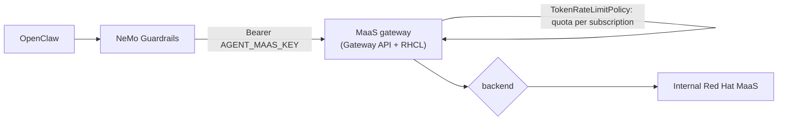

# Models-as-a-Service (MaaS) with an external model

Goal: the agent never talks to the upstream model directly. It calls the RHOAI MaaS
gateway with **its own subscription key**, which carries a **token quota**
(control layer 07 - Scale).

## How it is built (validated on RHOAI 3.5.3)

| Object | File | Notes |
|---|---|---|
| Gateway `maas-default-gateway` + Route, PostgreSQL, Authorino CA trust | `phase1-platform/rhoai/maas-*.yaml`, `scripts/maas-prereqs.sh` | MaaS prerequisites (test-log F-02/F-03) |
| `ExternalModel` + `MaaSModelRef` `aiops-model` | `model.yaml.tmpl` (rendered) | Internal Red Hat MaaS as external OpenAI provider (Technology Preview) |
| Consumer identities | `consumers.yaml` | One ServiceAccount per consumer |
| `MaaSAuthPolicy` + `MaaSSubscription` (`openclaw-agent`, `other-consumer`) | `access.yaml` | Token quota per subscription |
| API keys | `scripts/maas-mint-keys.sh` | `POST /maas-api/v1/api-keys` with a short-lived SA token; stored in `.env` |

Call format: `POST https://<gateway>/aiops-models/aiops-model/v1/chat/completions` with
`Authorization: Bearer <key>` and `"model": "aiops-model"` (the MaaS name, not the upstream name).

The agent does not call MaaS directly: NeMo Guardrails calls it with the agent key
(topology B, see `docs/architecture.md`).
