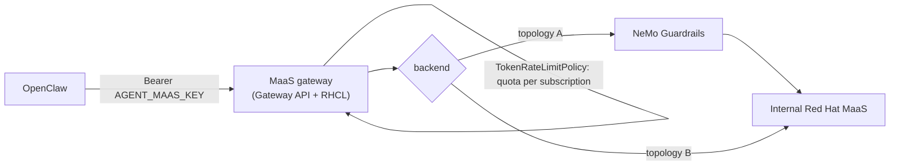

# Models-as-a-Service (MaaS) with an external model

Goal: the agent never talks to the upstream model directly. It calls the RHOAI MaaS
gateway with **its own subscription key**, which carries a **token quota**
(control layer 07 - Scale).



## Status of the APIs

| Item | Status in RHOAI 3.5 | Notes |
|---|---|---|
| MaaS (`kserve.modelsAsService`) | GA (3.4) | Enabled in `phase1-platform/rhoai/datasciencecluster.yaml` |
| MaaS pointing to an **external** model | Technology Preview (3.5) | This is what makes per-agent quota possible without GPUs |

The CR kinds/fields for external models changed between 3.4 and 3.5. The files in this
folder are **templates**: after the operator is installed run

```bash
make explain-crds          # dumps `oc explain` for MaaS / guardrails / MLflow / EvalHub CRDs
oc api-resources | grep -Ei 'maas|tier|subscription|externalmodel'
```

and adjust `external-model.yaml` / `subscriptions.yaml` to the schema actually served
by the cluster. Record the final schema in `docs/open-points.md`.

## Steps

1. Create the Secret holding the upstream credential (done by `scripts/create-secrets.sh`,
   secret `upstream-maas-credentials` in namespace `aiops-models`).
2. Register the external model (`external-model.yaml`).
3. Create two subscriptions/tiers (`subscriptions.yaml`):
   - `openclaw-agent` - low quota, used by the agent (and exhausted in test case 5);
   - `other-consumer` - independent quota, proves isolation between consumers.
4. Generate one key per subscription in the RHOAI dashboard (**Models-as-a-Service >
   API keys**) and save them in `.env` as `AGENT_MAAS_KEY` / `OTHER_CONSUMER_MAAS_KEY`.
5. Validate: `scripts/01-maas-egress-check.sh "$RHOAI_MAAS_URL" AGENT_MAAS_KEY`
   and `python3 model-validation/tool_calling_test.py --base-url "$RHOAI_MAAS_URL" --api-key "$AGENT_MAAS_KEY"`.

## Fallback (risk table: "MaaS with external model does not work")

OpenClaw points directly to the internal Red Hat MaaS (`MAAS_INTERNAL_URL`), and quota
is demonstrated only with the internal MaaS' own key limits. Change `MAAS_BASE_URL` in
`manifests/phase3-agent/openclaw/agent.env` and record the decision.
