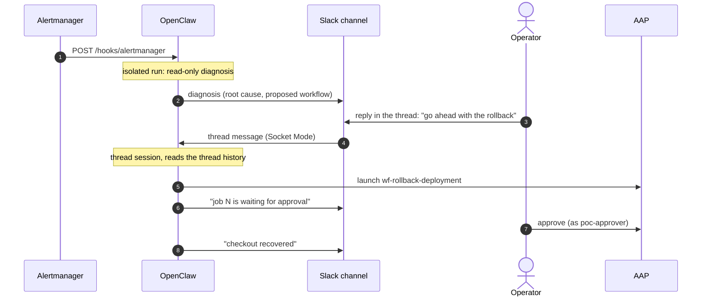

# Optional: Slack channel (human in the conversation)

**Status: tested on 2026-11-19, then disabled (`make slack-disable`).** Socket Mode connected,
alert diagnoses were posted to the channel, and a reply in the thread opened a normal agent
session with the diagnosis in its history. The follow-up stopped at the AAP launch call, which
the corporate MaaS mangles when streaming (docs/test-log.md F-18), not at the channel. Issues
found on the way: F-16 (EgressFirewall, fixed) and F-17 (claimed launch, mitigated). Without
the channel the POC works with the limitation described in
[Without Slack](#without-slack-isolated-alert-sessions).

## Why

An alert that arrives through the webhook runs as an **isolated, one-shot agent run**: it
diagnoses and finishes. That run is automation, not a conversation. In production, its result
is **delivered to a chat channel**, and the operator continues there: they read the diagnosis
and reply in the thread ("go ahead with the rollback"), which opens a normal session for the
agent.



## What it adds, layer by layer

| Layer | Change | Notes |
|---|---|---|
| 01 Isolation | `EgressFirewall` allows only `slack.com`, `wss-primary.slack.com` and `wss-backup.slack.com` (explicit names: wildcards need the `DNSNameResolver` feature, test-log F-16) and denies every other external address. A NetworkPolicy allows HTTPS to **external** IPs only: private ranges and the cluster/service networks are excluded | The Kubernetes API, other namespaces and the corporate MaaS stay blocked. `registry.npmjs.org` is allowed only while the plugin is installed |
| 02 Identity | Bot and app tokens in `poc-vault/openclaw-slack-credentials`, copied by ESO to `openclaw/openclaw-slack` | Optional env vars in the gateway: no Secret means no Slack |
| 03 Tools | Slack actions disabled (`reactions`, `messages`, `pins`, `search`, ...), no native commands, no config writes | The agent can only reply where it was addressed |
| 03 Tools | Who may instruct the agent: **one channel**, **named operator IDs**, no DMs | Messages from anyone else are ignored |
| 06 Action | Unchanged | Write actions still need the AAP approval by `poc-approver` |

Socket Mode is outbound only: Slack needs **no inbound Route** to the cluster.

## Prerequisites (outside the cluster)

### 1. Choose the workspace and the channel

- Apps are created in the Slack developer portal (**https://api.slack.com/apps**), not in the
  Slack client: the client's *Apps* directory only lists apps that already exist.
- In an **Enterprise Grid** organization, the client shows the organization, but the portal
  lists the **workspaces inside it**. Pick the internal workspace where your team works,
  **never a workspace shared with external organizations**: the agent posts cluster
  diagnostics (pod names, log lines, events).
- Corporate workspaces usually require **admin approval to install** an app (the install
  button reads *Request to install*). Plan for that lead time; until it is approved, the POC
  runs without the channel ([Without Slack](#without-slack-isolated-alert-sessions)).
- Create a channel for the alerts (for example `#aiops-poc-alerts`). A private channel works
  too (the manifest includes the `groups:*` scopes).

### 2. Create the app from the manifest

1. **https://api.slack.com/apps → Create New App → From a manifest**.
2. Select the workspace (step 1) → **Next**.
3. Choose the **JSON** tab, replace the whole content with
   [slack-app-manifest.json](slack-app-manifest.json) → **Next** → review → **Create**.

What the manifest contains (and leaves out):

| Item | Value | Why |
|---|---|---|
| Socket Mode | enabled | Outbound WebSocket from the cluster: no public endpoint for Slack to call |
| Bot scopes | `app_mentions:read`, `channels:history`, `channels:read`, `groups:history`, `groups:read`, `chat:write`, `users:read` | Read the alert channel and its threads, post replies, resolve user IDs |
| Bot events | `app_mention`, `message.channels`, `message.groups` | Mentions and thread replies in public or private channels |
| Left out | DMs (`im:*`), App Home, Agent View, slash commands, files, reactions, pins | Not used by the POC; DMs are also disabled in the OpenClaw config |

This is a reduced version of the plugin's *Minimal* manifest
(`/app/docs/channels/slack/setup.md` in the OpenClaw image), tested with plugin 2026.9.8
(post to the channel, receive thread replies). If the gateway log reports a missing scope
after a plugin upgrade, add it in *OAuth & Permissions* and reinstall the app.

### 3. Generate the app-level token (Socket Mode)

**Basic Information → App-Level Tokens → Generate Token and Scopes**: any name (e.g.
`socket`), scope **`connections:write`** → **Generate** → copy the `xapp-...` token.

### 4. Install the app

**OAuth & Permissions → Install to Workspace** (or **Request to install**, then wait for the
approval). After the installation, copy the **Bot User OAuth Token** (`xoxb-...`) from the same
page.

### 5. Add the bot to the channel and collect the IDs

- In the channel: `/invite @OpenClaw AIOps`.
- **Channel ID:** channel name → *About* (or *Channel details*) → ID at the bottom (`C...`).
- **Operator IDs:** each operator's profile → **⋮** → *Copy member ID* (`U...`). Only these
  people can instruct the agent.

### 6. Fill in `.env`

| Variable | Value |
|---|---|
| `SLACK_BOT_TOKEN` | `xoxb-...` (step 4) |
| `SLACK_APP_TOKEN` | `xapp-...` (step 3) |
| `SLACK_CHANNEL_ID` | `C...` (step 5) |
| `SLACK_OPERATOR_IDS` | `U...` IDs, space separated (step 5) |

The tokens stay in `.env` (never committed) and in `poc-vault`; they reach the agent only
through ESO.

## Enable / disable

```bash
make agent           # once: adds the optional SLACK_* env vars to the Deployment
make slack-enable    # vault + ESO, egress rules, plugin install, channel config, restart
make slack-disable   # back to the default POC
scripts/slack.sh status
```

`scripts/slack.sh enable` does, in order:

1. Writes the tokens to `poc-vault` and applies the `ExternalSecret`.
2. Applies the **temporary** EgressFirewall (Slack + npm) and waits until its status is
   `Rules applied` (otherwise it stops), then the external-HTTPS NetworkPolicy, and restarts
   the agent so it gets the tokens.
3. Installs the plugin `@openclaw/slack@2026.9.8` (same version as the gateway; it is not
   bundled in the image) on the agent PVC.
4. Switches the EgressFirewall to **Slack only**.
5. Patches the running config (`openclaw-slack.json5.tmpl`): adds the plugin to
   `plugins.allow`, configures the channel, and changes the alert mapping to `deliver: true`,
   `channel: slack`, `to: channel:<SLACK_CHANNEL_ID>`. Then it restarts the agent.

After enabling, `make isolation` still reports the Internet as blocked: the probe uses a
non-Slack host.

### Supply chain note

The plugin and its dependencies (`@slack/bolt`, `@slack/web-api`, ...) are downloaded from npm
into the agent PVC: third-party code inside the agent pod, like the OpenClaw image itself.
For anything beyond a POC, build an image that contains the plugin (scanned and pinned) and
drop the npm window from the EgressFirewall.

## Without Slack: isolated alert sessions

This is the state of the POC while the channel is not provided.

- Each alert creates an isolated session (`agent:main:cron:<id>`, named
  `Alert <alertname>`). The Control UI shows the diagnosis there (**read only**).
- **Typing in that session fails** with *"Worker turn session key does not match its
  placement"*: the session is bound to the one-shot run that created it. Elapsed time has
  nothing to do with it.
- To act on the diagnosis (case 2), open a **new chat** in the Control UI and paste the
  context (alert, root cause, proposed workflow and parameters). The handoff from automation
  to human is manual: that is the gap the channel closes.

A different option is to configure the mapping with `sessionMode: "persistent"` and a fixed
`sessionKey`: alerts would land in one ordinary Control UI session. That is good enough for a
demo, but every alert shares one growing context, and it is not how the product is meant to
be used. It is not implemented.
